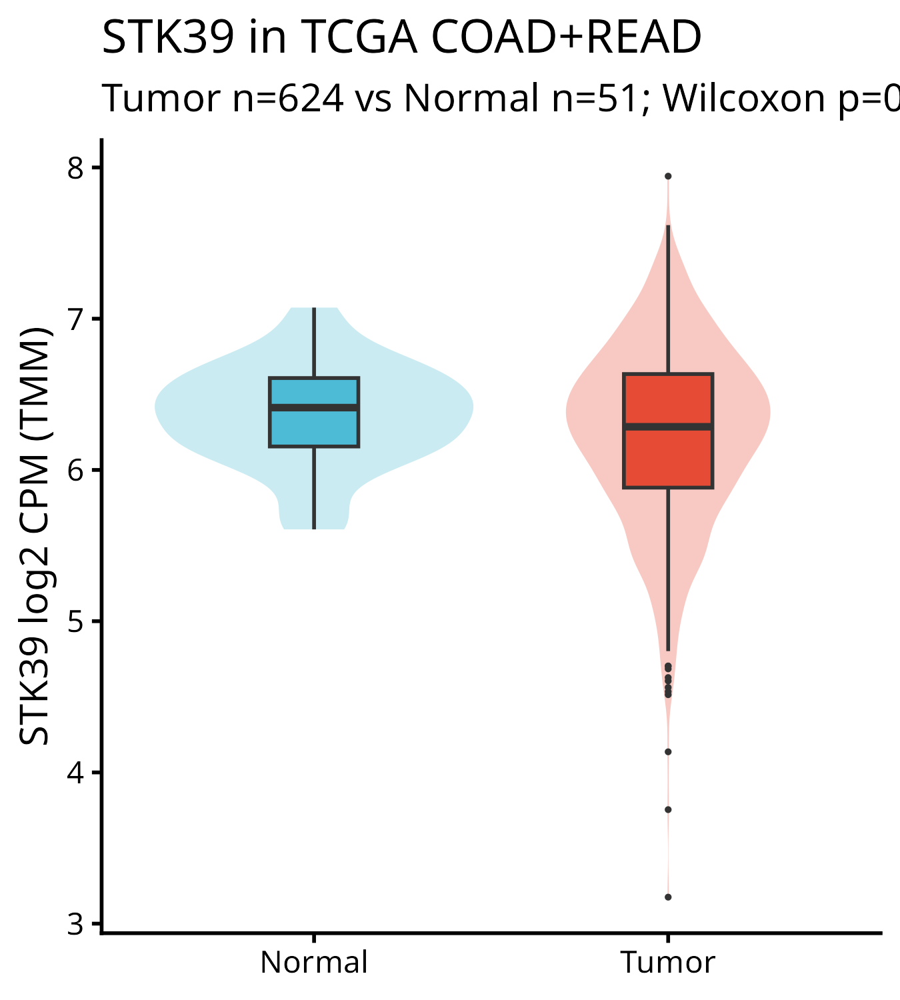
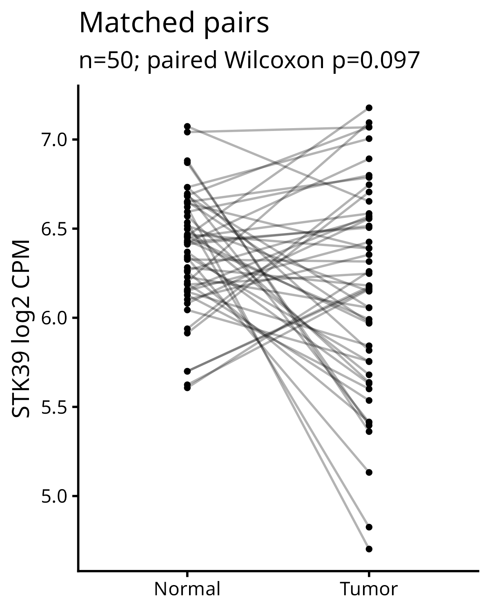
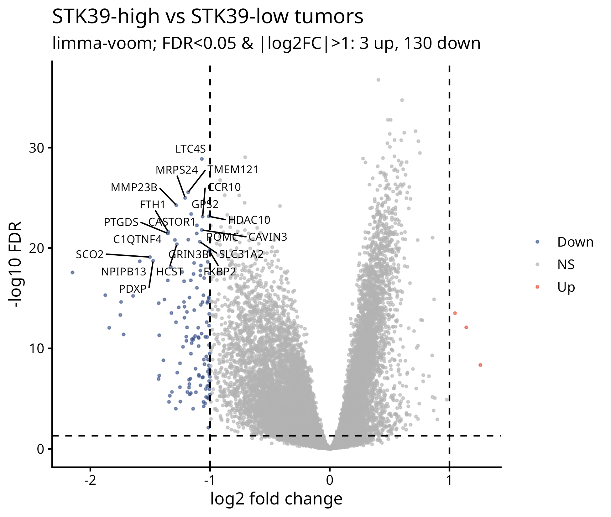
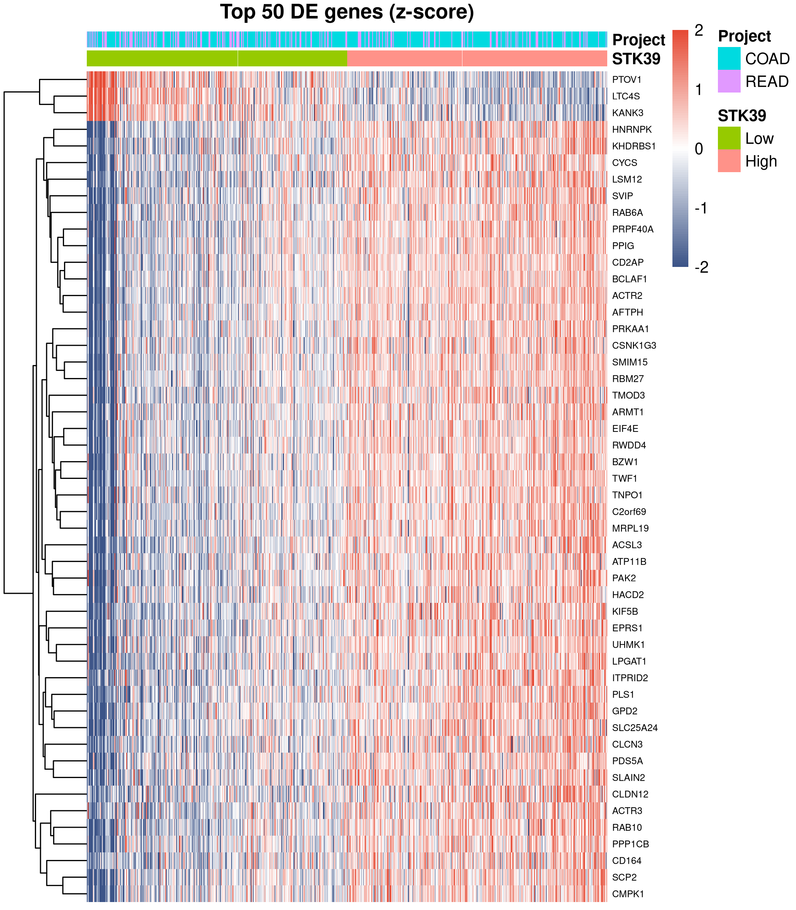
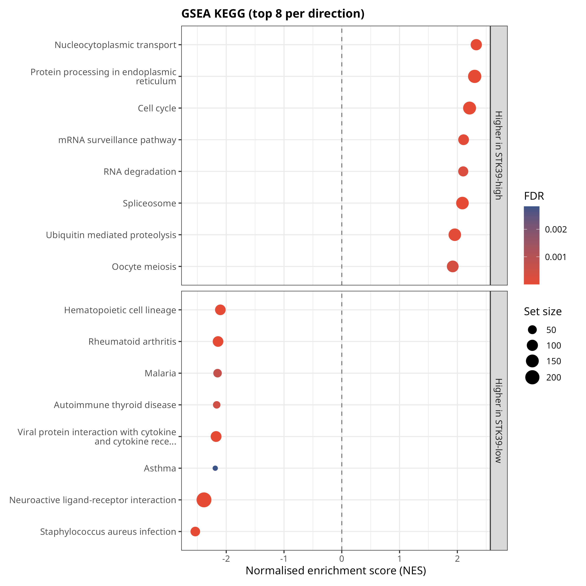
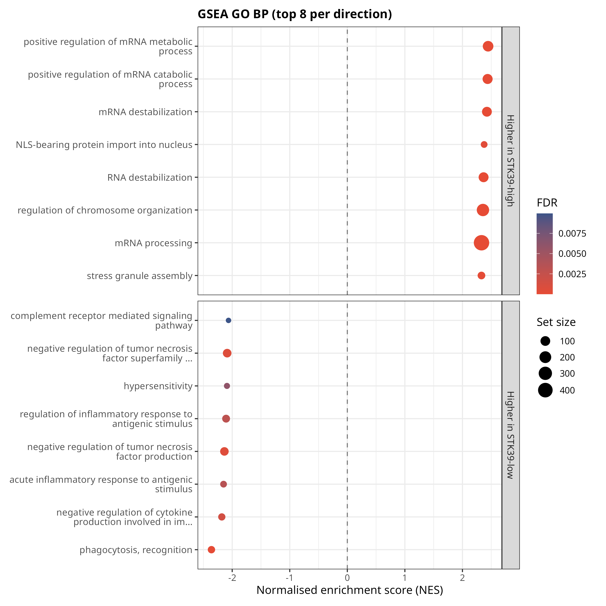
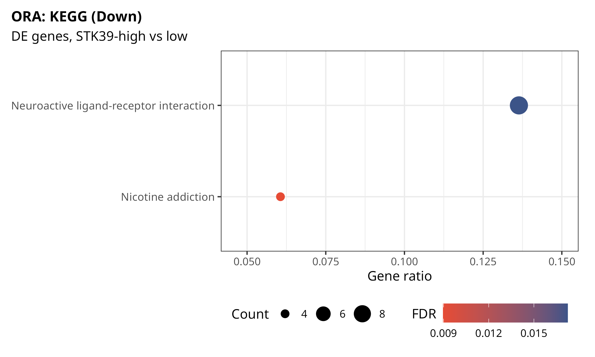
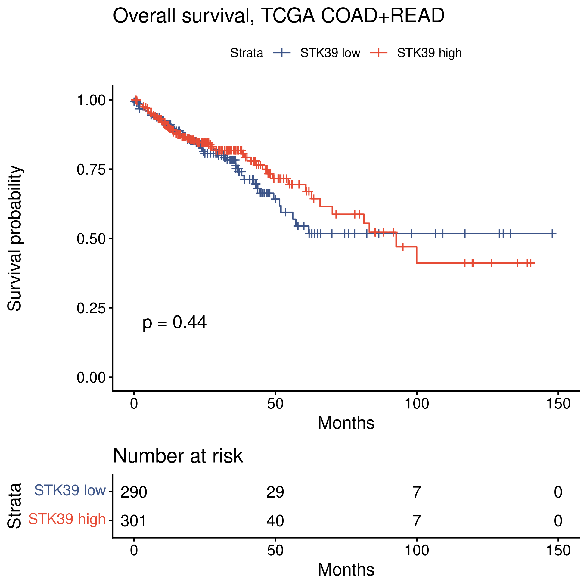

```{r setup, include=FALSE}
knitr::opts_chunk$set(echo=FALSE, message=FALSE, warning=FALSE)
s <- readRDS("results/summary.rds"); g <- readRDS("results/gsea_summary.rds"); f <- function(x,d=3) signif(x,d)
cx <- s$cox
```
## Data
UCSC Xena GDC hub (STAR gene counts, log2(count+1), back-transformed to counts; GDC clinical and OS tables). One primary tumor (`-01`) and/or one solid tissue normal (`-11`) sample per patient: **`r s$tn$n_tumor` tumors, `r s$tn$n_normal` normals**. Expression = TMM-normalised log2 CPM.

## 1. Tumor vs normal
Median STK39 log2CPM: tumor `r f(s$tn$median_tumor)` vs normal `r f(s$tn$median_normal)`; Wilcoxon p = `r f(s$tn$p_unpaired)`. In `r s$tn$n_pairs` matched pairs the median tumor−normal difference was `r f(s$tn$median_pair_diff)` (paired Wilcoxon p = `r f(s$tn$p_paired)`; `r round(100*s$tn$frac_pairs_lower_in_tumor)`% of pairs lower in tumor). **No significant tumor/normal difference.**

{width=45%} {width=40%}

## 2. STK39-high vs STK39-low tumors (median split, limma-voom, adjusted for COAD/READ)
`r s$de$n_genes_tested` protein-coding genes tested; `r s$de$n_fdr05_any` had FDR < 0.05 (large n gives power for small shifts), but only **`r s$de$n_up` up / `r s$de$n_down` down** passed FDR < 0.05 & |log2FC| > 1. Top down: `r paste(head(s$top_down,10), collapse=", ")`. Up: `r paste(s$top_up, collapse=", ")`.

{width=70%}

{width=70%}

## 3. Enrichment
ORA (|log2FC|>1 genes): GO BP down = `r s$enr_n["GO_Down"]` terms, KEGG down = `r s$enr_n["KEGG_Down"]` (`r paste(s$enr_top$KEGG_Down$Description, collapse="; ")`); too few up genes for ORA.
GSEA on the limma t-statistic: **`r g$GSEA_GO_BP$n_sig` GO BP** (`r g$GSEA_GO_BP$n_pos` positive / `r g$GSEA_GO_BP$n_neg` negative) and **`r g$GSEA_KEGG$n_sig` KEGG** pathways at FDR<0.05. STK39-high tumors are enriched for RNA processing, spliceosome, ER protein processing and cell cycle; STK39-low tumors for immune/inflammatory and neuroactive-ligand programs.

```{r}
knitr::kable(rbind(g$GSEA_KEGG$top_pos[1:5,], g$GSEA_KEGG$top_neg[1:5,]), digits=4, caption="Top GSEA KEGG pathways")
```
{width=80%}

{width=80%}

{width=70%}

## 4. Survival (overall survival)
n = `r s$n_surv`, `r s$events` deaths. Log-rank (median split) p = `r f(s$p_logrank)`.

```{r}
knitr::kable(data.frame(Model=rownames(cx), HR=f(cx[,"HR"]), CI=paste0(f(cx[,"lo"]),"–",f(cx[,"hi"])), p=f(cx[,"p"]), n=cx[,"n"], events=cx[,"events"]), caption="Cox models (continuous = per 1 SD of log2CPM; multivariable adjusts for age, sex, stage I–II vs III–IV, COAD/READ)")
```
**STK39 was not associated with OS** (proportional-hazards assumption not violated, global Schoenfeld p = `r f(s$zph["GLOBAL","p"])`). Age and stage III–IV were strong predictors, as expected.

{width=60%}

## Limitations
Only 51 normal samples (50 matched pairs); bulk RNA-seq is confounded by tumor purity and stromal/immune content, which likely drives much of the high-vs-low signal (immune programs in STK39-low); median split is arbitrary; OS has limited events and TCGA follow-up is short; no external validation cohort; associations are correlative only.

## Reproducibility
See `README.md`, `scripts/`, `sessionInfo.txt`.
